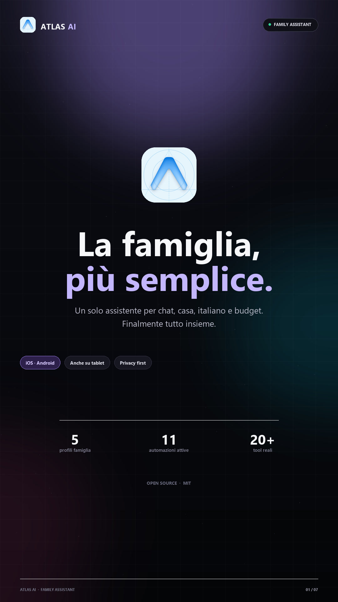
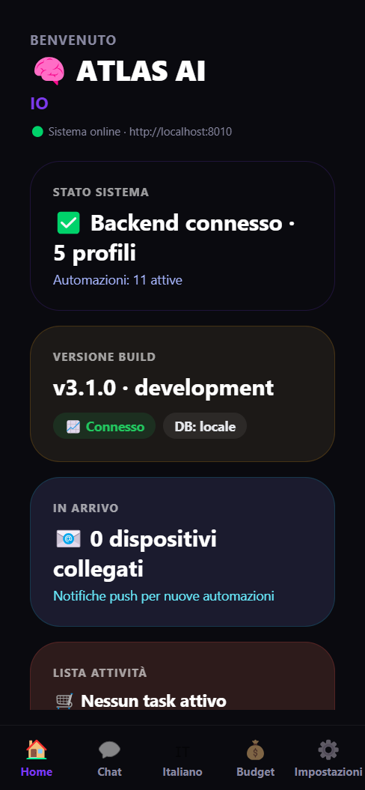
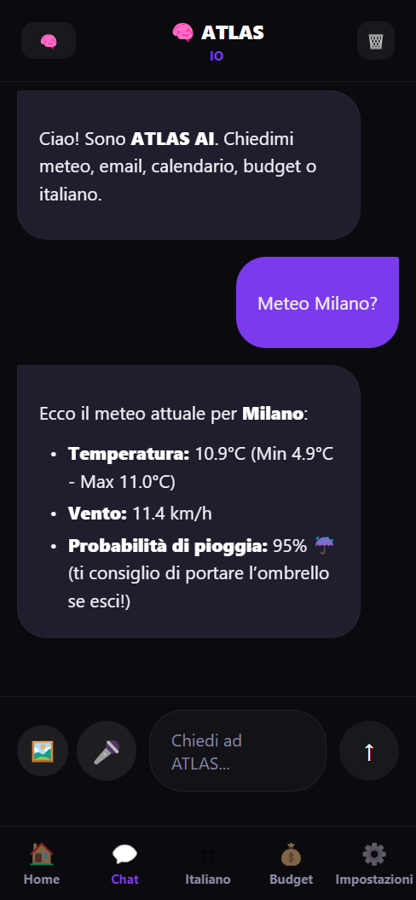
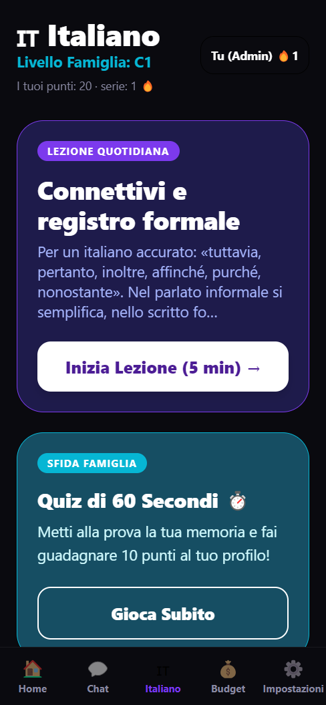
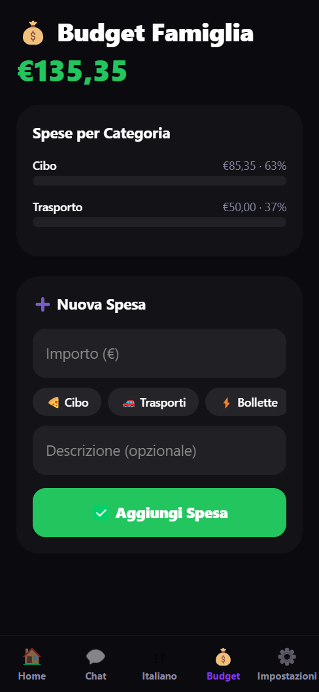
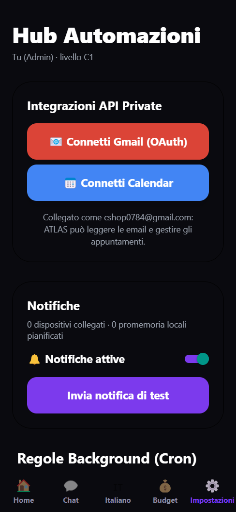
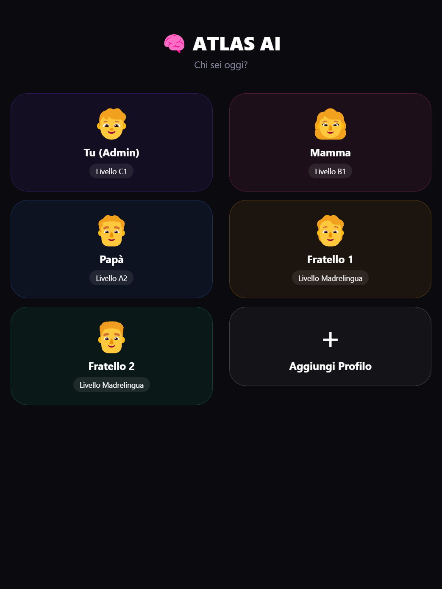

# 🧠 ATLAS AI v3.2

Assistente AI **family-first** con backend Python/FastAPI + app mobile React Native (Expo).

> Pensato per famiglie italiane: chat AI multi-utente con accesso PIN, profili famiglia,
> liste condivise, budget, PDF reali, automazioni pianificate con notifiche push,
> lezioni di italiano, integrazione reale con Gmail/Calendar e server MCP, e un
> **agente browser Chromium** che apre siti, clicca, compila moduli e legge pagine dinamiche.

**Licenza MIT** · CI su GitHub Actions · 166 test backend · TypeScript strict a 0 errori

[](https://github.com/AhsenKurtoski/atlas-ai/actions/workflows/ci.yml)
[](https://github.com/AhsenKurtoski/atlas-ai/actions/workflows/e2e.yml)
[](https://github.com/AhsenKurtoski/atlas-ai/actions/workflows/ios-build.yml)
[](https://github.com/AhsenKurtoski/atlas-ai/actions/workflows/android-apk.yml)

<p align="center">
  <a href="media/atlas-ai-demo.mp4"></a>
  <a href="screenshots/01-home.png"></a>
  <a href="screenshots/02-chat.png"></a>
</p>

<p align="center"><a href="media/atlas-ai-demo.mp4"><strong>▶ Guarda il video demo (18 secondi)</strong></a> · <a href="docs/INSTALL.md"><strong>📲 Installa su Android, iPhone o tablet</strong></a></p>

---

## 📲 Installazione rapida

| Dispositivo | Come |
|---|---|
| **Android (telefono/tablet)** | Scarica l'[APK release](https://github.com/AhsenKurtoski/atlas-ai/releases/download/android-v3.2.0/ATLAS-AI-android.apk) (~73 MB), apri il file e consenti l'installazione da browser. |
| **iPhone / iPad** | Simulatore con Mac, firma gratuita (7 giorni) o TestFlight. Apple richiede una firma: **non esiste un'installazione iOS gratuita in 5 minuti**. |
| **Tablet** | Stessa app: layout responsive a due colonne, rotazione portrait/landscape, nessuna build separata. |
| **Sviluppo** | Backend + `npx expo start`; guida rapida in [`docs/QUICKSTART.md`](docs/QUICKSTART.md). |

La guida passo-passo, i limiti della firma iOS e la risoluzione dei problemi sono in
**[docs/INSTALL.md](docs/INSTALL.md)**, **[docs/IOS.md](docs/IOS.md)** e
**[docs/QUICKSTART.md](docs/QUICKSTART.md)**.

---

## 📸 Screenshot

| Home | Chat AI | Italiano |
|---|---|---|
|  |  |  |

| Budget | Impostazioni | Tablet |
|---|---|---|
|  |  |  |

Screenshot reali dell'app (build web con lo stesso codice React Native). Il video
9:16 è in **[media/atlas-ai-demo.mp4](media/atlas-ai-demo.mp4)** con poster
**[media/atlas-ai-poster.jpg](media/atlas-ai-poster.jpg)**.

---

## ⏰ Promemoria intelligenti e lista spesa

Scrivi in chat come parleresti a una persona:

> «Ricordami che verso le 4-5 devo andare a fare la spesa da Lidl»

ATLAS crea un promemoria reale, allega la lista della spesa ancora aperta e
pianifica una **notifica locale sul telefono** (funziona anche ad app chiusa,
senza EAS o Firebase). Se dici «senza lista», non la allega. Dalla schermata
**Lista spesa** puoi aggiungere, completare, eliminare e pulire gli elementi;
in **Impostazioni → Promemoria** vedi e annulli quelli attivi.

La prima volta il sistema chiede il permesso notifiche. Se lo neghi, il
promemoria resta salvato nella lista ma il telefono non può avvisarti: ATLAS
te lo dice esplicitamente invece di fingere che sia tutto attivo.

---

## 🏗️ Architettura

```
┌──────────────────────────────┐      HTTP / JSON       ┌─────────────────────────────────────────┐
│   APP MOBILE                 │ ─────────────────────▶ │  BACKEND FASTAPI (Python 3.11-3.13)     │
│   React Native · Expo 51     │  Bearer token firmato  │                                         │
│   NativeWind / Tailwind      │ ◀───────────────────── │  - 30 endpoint REST                     │
│   AsyncStorage (persistenza) │   Chat + Pin + Push    │  - 50 tool reali per Gemini             │
│   React Navigation 6         │                        │  - 10 tool browser (Chromium headless)  │
│   expo-notifications         │                        │  - Auth PIN bcrypt + token HMAC 8h      │
└──────────────────────────────┘                        │  - 12 automazioni APScheduler           │
                                                        │  - DB: Supabase ▶ fallback JSON locale  │
                                                        │  - Client MCP (JSON-RPC/HTTP)           │
                                                        └─────────────────────────────────────────┘
                                                                      │
                                                                      ▼
                                        ┌────────────────────────────────────────────────┐
                                        │  SERVIZI GRATUITI (nessun costo obbligatorio)  │
                                        │  Google Gemini · Expo Push · Open-Meteo        │
                                        │  CoinGecko · DuckDuckGo · Google News RSS      │
                                        │  MyMemory · Yahoo Finance · ipwho.is           │
                                        │  Gmail/Calendar (OAuth) · server MCP           │
                                        │  Chromium headless (agente browser)            │
                                        └────────────────────────────────────────────────┘
```

---

## 🚀 Avvio rapido

### 1. Backend (FastAPI)

```bash
cd backend
# Windows: py -3.12 -m venv venv    (NON usare il python 3.15 di sistema)
# macOS/Linux: python3 -m venv venv
.\venv\Scripts\activate             # macOS/Linux: source venv/bin/activate

pip install -r requirements.txt
python -m playwright install chromium   # Chromium per l'agente browser

# Opzionale: personalizza le variabili (senza .env parte in modalità locale)
copy .env.example .env      # macOS/Linux: cp .env.example .env

uvicorn main:app --reload --port 8000
# ✅ Health check: http://localhost:8000/
```

> Usa **Python 3.11, 3.12 o 3.13**. Le dipendenze pinned (pydantic/supabase) non supportano
> ancora Python 3.15.
>
> Se la porta 8000 è occupata: `uvicorn main:app --port 8010` e imposta
> `EXPO_PUBLIC_API_URL=http://<IP-del-PC>:8010` nel frontend.

### 2. App mobile (Expo)

```bash
cd frontend
npm install
npx expo start
```

> ⚠️ **Compatibilità Expo Go**: il progetto usa **Expo SDK 51**. L'Expo Go degli store
> supporta solo l'SDK più recente, quindi per provarlo su un telefono serve una
> **development build** (`eas build --profile development`) o un client Expo Go per
> SDK 51 (emulatori). Per pubblicare sugli store oggi conviene pianificare l'upgrade
> a SDK 57/58: è una migrazione separata (React Native/Reanimated/expo-av), non inclusa
> in questo intervento.

```bash
npm install -g eas-cli
eas login
eas init                              # crea il projectId (serve anche per le push)
eas build --profile development --platform android
```

| Comando | Cosa fa |
|---|---|
| `npm run start` | Bundler Expo (QR code per Expo Go) |
| `npm run android` | Emulatore/dispositivo Android |
| `npm run ios` | Simulatore iOS (solo macOS) |
| `npm run typecheck` | `tsc --noEmit` (strict, 0 errori) |
| `npm run export:web` | Export statico web in `dist/` |
| `npm run test:e2e` | Playwright: login + lista spesa (backend su `:8010`) |

---

## 🔐 Variabili d'ambiente (tutte opzionali)

| Variabile | Scopo | Default |
|---|---|---|
| `APP_ENV` | `development` / `production` | `development` |
| `ATLAS_SECRET_KEY` | Segreto firma token (generato se assente) | auto |
| `TOKEN_TTL_HOURS` | Durata sessione | `8` |
| `CORS_ALLOWED_ORIGINS` | Origini per la preview web | `*` |
| `SUPABASE_URL` / `SUPABASE_SERVICE_KEY` | Database remoto (alias `SUPABASE_SERVICE_ROLE_KEY`) | *(vuoto = locale)* |
| `GOOGLE_API_KEY_1..3` | Chiavi Gemini (rotazione + fallback quota) | *(vuoto = no LLM)* |
| `GEMINI_MODEL` | Modello Gemini | `gemini-3.5-flash-lite` |
| `GOOGLE_CLIENT_ID` / `GOOGLE_CLIENT_SECRET` | Gmail + Calendar (OAuth gratuito) | *(vuoto = non collegato)* |
| `MCP_SERVERS` | Server MCP come JSON `{nome: {url}}` | *(vuoto = nessuno)* |
| `ATLAS_CITY` | Città per briefing e ombrello smart | `Milano` |
| `ALLOW_PRIVATE_FETCH` | Consenti fetch/browser verso IP privati (sicurezza) | `false` |
| `BROWSER_ENABLED` | Abilita l'agente browser | `true` |
| `BROWSER_HEADLESS` | Chromium senza finestra (server) | `true` |
| `BROWSER_SESSION_TTL` | Durata sessione browser per profilo (s) | `900` |
| `BROWSER_DNS_CACHE_TTL` | Cache DNS del route guard (s) | `60` |
| `AGENT_MAX_TOOL_TURNS` | Turni massimi di tool per risposta (browser multi-step) | `10` |
| `GITHUB_TOKEN` | Alza il rate limit GitHub | opzionale |
| `NEWSAPI_KEY` | NewsAPI (altrimenti Google News RSS) | opzionale |
| `AMADEUS_CLIENT_ID` / `_SECRET` | Ricerca voli (piano gratuito) | opzionale |
| `FIREBASE_CREDENTIALS` | Solo per token FCM nativi | opzionale |

**Frontend**: `EXPO_PUBLIC_API_URL` forza l'endpoint. Se assente viene risolto da IP LAN
Expo Go, poi `10.0.2.2` su emulatore Android, poi `localhost`.

---

## 🛡️ Sicurezza

| Controllo | Stato |
|---|---|
| PIN con hash bcrypt (rounds 12) — hash reali nei profili demo | ✅ |
| Token di sessione firmati HMAC-SHA256, TTL 8h, **stateless** (funzionano con più worker) | ✅ |
| Endpoint privati protetti da `Authorization: Bearer` (todos, budget, chat, impostazioni, profili) | ✅ |
| Rate limit PIN: 5/minuto per IP + 20/min chat | ✅ |
| Confronto a tempo costante, nessun `eval()` (parser AST) | ✅ |
| Error handler globale (nessuno stacktrace esposto) | ✅ |
| Segreto di firma persistito con permessi 600 (o da env) | ✅ |
| **Logout reale**: token revocato sul server (denylist fino a scadenza) | ✅ |
| **Ruoli**: solo l'amministratore `io` crea/elimina profili | ✅ |
| **Protezione SSRF** su fetch web e browser (DNS su navigazioni, XHR, iframe e immagini) | ✅ |
| **Prompt injection**: il testo delle pagine è trattato come dato non attendibile | ✅ |
| **Sessioni browser isolate per profilo** (cookie/pagine separati, TTL 15 min) | ✅ |
| **Scheduler a istanza singola** via lock di processo (niente notifiche duplicate) | ✅ |
| Token push morti disattivati automaticamente (`DeviceNotRegistered`) | ✅ |

---

## 👨‍👩‍👧‍👦 Multi-utente e privacy

Una istanza ATLAS = **una famiglia**. I dati sono separati in due livelli:

| Dati | Visibilità |
|---|---|
| Chat e memoria AI, punti/streak italiano, dispositivi push, sessione browser | **Per profilo** (token obbligatorio) |
| Lista spesa/todo, budget, impostazioni automazioni, account Google | **Condivisi dalla famiglia** |
| Creazione/eliminazione profili, PIN | **Solo amministratore** (`io`) |

Ogni richiesta privata richiede `Authorization: Bearer` e il backend ricava il profilo
dal token: non è possibile leggere i dati di un altro profilo passando uno slug diverso.
Per più famiglie servono istanze separate (o un fork con `family_id` nello schema).
L'account Gmail/Calendar è unico per la famiglia: chi lo collega autorizza tutti i membri
a usarlo tramite l'assistente.

**Privacy**: i messaggi e le foto della chat vengono inviati a Google Gemini per essere
elaborati. Il backend non salva le immagini su disco (restano solo nella cronologia locale
dell'app come testo); le email vengono lette solo se colleghi Gmail.

---

## ✅ Cosa funziona davvero

| Funzione | Stato | Richiede |
|---|---|---|
| Login PIN + sessione persistente + logout | ✅ reale | — |
| Chat AI + memoria conversazionale | ✅ reale | `GOOGLE_API_KEY_1` (Gemini free tier) |
| **Foto dalla galleria in chat** (analisi e OCR) | ✅ reale | `GOOGLE_API_KEY_1` (Gemini vision) |
| Dettatura vocale in chat | ✅ reale | `GOOGLE_API_KEY_1` (Gemini trascrive l'audio) |
| **Agente browser** (apre siti, clicca, compila, legge JS) | ✅ reale | Chromium (`playwright install chromium`) |
| **Promemoria intelligenti** creati in chat ("verso le 4-5 devo andare da Lidl") | ✅ reale | notifiche locali attive |
| **Lista spesa condivisa** con aggiunta, completamento, eliminazione e pulizia | ✅ reale | — |
| Budget per categoria + totale mese | ✅ reale | — |
| PDF A4 con condivisione iOS/Android e download web | ✅ reale | — |
| Dashboard con KPI reali | ✅ reale | — |
| Notifiche locali programmate (acqua, lezione, …) | ✅ reale | — |
| Push remote alle automazioni | ✅ reale | `extra.eas.projectId` in `app.json` |
| 12 automazioni (meteo, crypto, budget, email, italiano, calendario, promemoria) | ✅ reale | credenziali dei servizi usati |
| Lezioni + quiz italiano con punti/streak | ✅ reale | — |
| Gmail: lettura inbox e appuntamenti | ✅ reale | OAuth Google |
| Calendar: crea evento / agenda del giorno | ✅ reale | OAuth Google |
| Server MCP (tool discovery + call) | ✅ reale | `MCP_SERVERS` |
| Ricerca web, notizie, meteo, crypto, cambio, azioni, traduzioni, QR | ✅ reale | — |
| Voli | ✅ reale con Amadeus, altrimenti link reali | `AMADEUS_*` |

Nessun tool restituisce più un finto successo: se un servizio non è configurato, la risposta
lo dice e spiega come attivarlo.

---

## 🧪 Qualità & test

```bash
cd backend && pytest -q          # 166 test (18 browser Chromium reali + 2 test del loop agente)
cd frontend && npm run typecheck  # 0 errori (strict)
cd frontend && npm run test:e2e   # login + lista spesa nel browser (backend su :8010)
```

La CI esegue anche la build iOS per simulatore su macOS, installa e avvia
l'APK Android su un emulatore reale prima di pubblicare la release, e lancia
i test Playwright su ogni push.

| Suite backend | Copre |
|---|---|
| `test_security.py` | bcrypt, PIN, token, sanitizzazione |
| `test_tools.py` | calcolatrice AST, todo, budget, formule |
| `test_endpoints.py` | auth reale, 401, todos, budget, dashboard, notifiche, impostazioni, italiano, profili, Google |
| `test_mcp.py` | handshake MCP, tools/list, tools/call su server locale |
| `test_notifications.py` | invio Expo Push reale (server mock), ticket rifiutati, token per profilo |
| `test_google_oauth.py` | URL OAuth, state firmato, stato non configurato |
| `test_multiuser.py` | isolamento chat/push per profilo, ruoli admin, revoca del token al logout |
| `test_net_guard.py` | blocco SSRF verso loopback, reti private e metadata cloud |
| `test_scheduler_lock.py` | un solo processo esegue i job |
| `test_weather.py` | variabili Open-Meteo corrette e parsing meteo/previsioni |
| `test_chat_image.py` | invio foto: PNG valido, MIME/base64/dimensioni rifiutati correttamente |
| `test_browser.py` | Chromium reale: navigazione, click, form, select, scroll, storia, sessioni isolate, DNS su XHR/iframe/immagini, SSRF |
| `test_ai_loop.py` | loop Gemini con client finto: tool multipli, risposte function-response, limite turni |
| `test_reminders.py` | parser italiano ("verso le 4-5"), persistenza, API, scheduler push/local |

---

## 📂 Struttura

```
atlas-ai/
├── backend/
│   ├── main.py                 # API FastAPI (auth, chat, notifiche, impostazioni, italiano)
│   ├── app/
│   │   ├── ai_router.py        # Gemini + function calling + trascrizione audio
│   │   ├── scheduler.py        # 12 automazioni reali con push
│   │   ├── notifiche.py        # Expo Push / FCM
│   │   ├── core/
│   │   │   ├── database.py     # Supabase + fallback locale (todo, budget, token, settings)
│   │   │   ├── security.py     # bcrypt + token HMAC
│   │   │   ├── settings.py     # env centralizzate con alias
│   │   │   ├── net_guard.py    # protezione SSRF per i fetch web
│   │   │   ├── scheduler_lock.py  # un solo worker esegue i job
│   │   │   ├── schemas.py      # Pydantic v2
│   │   │   └── logging_config.py
│   │   ├── services/
│   │   │   ├── google_oauth.py # OAuth Gmail/Calendar
│   │   │   └── browser.py      # agente Chromium: worker, sessioni, SSRF
│   │   └── tools/              # 50 tool (browser, family, finance, travel, utility, MCP, italiano)
│   ├── tests/                  # 166 test
│   └── supabase_schema.sql
└── frontend/
    ├── App.tsx                 # AuthContext, sessione, navigazione, notifiche
    └── src/
        ├── config.ts
        ├── services/api.ts     # client tipizzato + gestione 401
        ├── services/notifications.ts
        └── screens/            # Profile · Home · Chat · Italiano · Budget · Impostazioni
```

---

## 🤝 Open source

- **Licenza**: [MIT](LICENSE) — puoi usare, modificare e distribuire il progetto.
- **Contributi**: leggi [CONTRIBUTING.md](CONTRIBUTING.md) (setup, test obbligatori, regole).
- **Sicurezza**: segnalazioni private secondo [SECURITY.md](SECURITY.md); non aprire issue pubbliche per le vulnerabilità.
- **CI**: [`.github/workflows/ci.yml`](.github/workflows/ci.yml) esegue `pytest` e `tsc --noEmit`; [`e2e.yml`](.github/workflows/e2e.yml) esegue gli smoke test Playwright; [`ios-build.yml`](.github/workflows/ios-build.yml) compila l'app iOS per simulatore.
- **Nessun segreto nel repo**: `.env` e `_local_db/` sono ignorati; usa `.env.example` come modello.
- **Agente browser**: architettura, tool e limiti in [`docs/BROWSER.md`](docs/BROWSER.md).
- **Guida di test passo-passo**: [`docs/TESTING_GUIDE.md`](docs/TESTING_GUIDE.md).
- **Installazione Android/iOS/tablet**: [`docs/INSTALL.md`](docs/INSTALL.md).
- **Percorso rapido e limiti reali**: [`docs/QUICKSTART.md`](docs/QUICKSTART.md).
- **iOS, iPad, firma e TestFlight**: [`docs/IOS.md`](docs/IOS.md).
- **Matrice funzionalità e prerequisiti**: [`docs/FEATURES.md`](docs/FEATURES.md).
- **Sempre online gratis**: [`docs/DEPLOY_FREE.md`](docs/DEPLOY_FREE.md) (Oracle Always Free + Tailscale Funnel).
- **Media**: screenshot in [`screenshots/`](screenshots/) e video demo in [`media/atlas-ai-demo.mp4`](media/atlas-ai-demo.mp4).

## 💸 Costi

Tutto il percorso base è **gratuito**: Gemini free tier, Expo Push, Open-Meteo, CoinGecko,
DuckDuckGo, Google News RSS, MyMemory, Supabase free tier, OAuth Google, Amadeus self-service
(free tier). Nessun servizio a pagamento è richiesto.

Vedi [REVIEW.md](REVIEW.md) per l'audit completo, le correzioni fatte e le raccomandazioni.

---

**Ti è utile?** Lascia una ⭐ al repository: aiuta altre famiglie a trovarlo e
mantiene visibile il progetto open source. Non ci sono sponsorizzazioni né dati
venduti a terzi.
