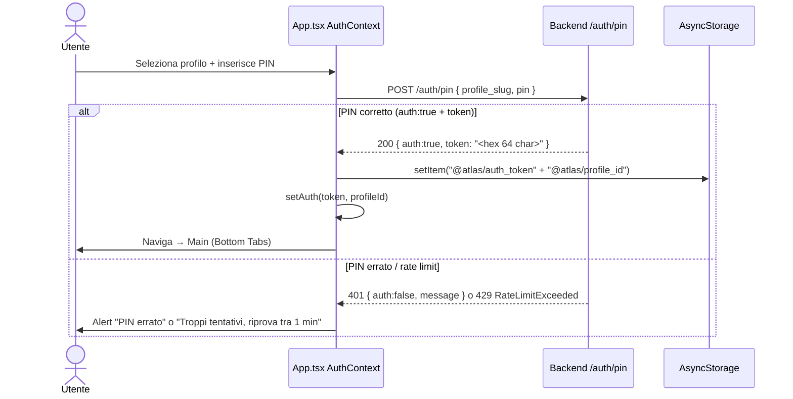

# Frontend ATLAS AI — Guida tecnica

Expo SDK 51 · React Native 0.74 · TypeScript strict · NativeWind (Tailwind 3.3) · React Navigation 6 · AsyncStorage

---

## 📋 Prerequisiti

- **Node.js 20+** (consigliato LTS)
- `npm` o `pnpm` / `yarn`
- *Opzionale*: [Expo Go](https://expo.dev/go) installato su dispositivo iOS/Android (per test reali)
- *Opzionale*: Android Studio (emulatore) o Xcode (simulatore iOS)

---

## 🏁 Installazione & Avvio

```bash
cd frontend

# 1. Installa dipendenze
npm install
# oppure:  pnpm install / yarn install

# 2. Avvia bundler Metro
npx expo start

#    Alternative:
npx expo start --android   # Apri emulatore Android
npx expo start --ios       # Apri simulatore iOS (solo macOS)
npx expo start --web       # Preview web per test veloci
```

✅ Sul dispositivo con **Expo Go**: scansiona il QR code mostrato nel terminale.

---

## 🔐 Configurazione URL backend (3 livelli fallback)

L'URL del backend è risolto **dinamicamente** in [src/config.ts](src/config.ts) — nessun hardcode:

| Priorità | Fonte | Esempio | Quando si usa |
|---|---|---|---|
| 1 (ALTA) | `EXPO_PUBLIC_API_URL` | `https://api.atlas.miodominio.it` | Build production/staging |
| 2 | `Constants.expoConfig.hostUri` (Expo Go) | `http://192.168.1.123:8081` → porta 8000 | Sviluppo locale su WiFi (stessa rete) |
| 3 | Default hardcoded | `http://localhost:8000` | Emulatore Android (con `adb reverse`) o simulatori iOS |

```bash
# Build production: forzare backend remoto
EXPO_PUBLIC_API_URL=https://api.atlas.miodominio.it npx expo start
```

---

## 🧩 Architettura frontend

```
App.tsx (Root)
├── <AuthProvider> (AuthContext + AsyncStorage persistence)
│   └── <NavigationContainer>
│       ├── Root Stack Navigator
│       │   ├── "Auth"            ← PIN verification via apiService.verifyPin()
│       │   └── "Main" (Bottom Tabs)
│       │       ├── HomeScreen     (dashboard, stato backend, todos preview)
│       │       ├── ChatScreen     (AI chat con cronologia persistente, Markdown)
│       │       ├── TodosScreen    (CRUD todos via backend /todos)
│       │       ├── BudgetScreen   (spese + riepilogo per categoria /budget)
│       │       └── ProfileScreen  (switch profilo, logout, versione app)
│       └── * Auth flow auto-redirect se token mancante
│
src/services/api.ts        # ApiService singleton · 15s timeout · Bearer token auto
src/config.ts              # URL dinamico + costanti app
shims.d.ts                 # AsyncStorage stub + assets modules (typecheck friendly)
nativewind-env.d.ts        # className props su View/Text/... (NativeWind)
```

---

## 🔑 Flusso autenticazione



Tutti gli screens nel Tab **Main** ricevono `profileId` + usano `useAuth()` hook per `authToken`.

---

## 🛠️ Comandi utili

| Comando | Cosa fa |
|---|---|
| `npm run start` | Avvia Expo bundler (alias `npx expo start`) |
| `npm run android` | Avvia su emulatore Android |
| `npm run ios` | Avvia simulatore iOS (solo macOS) |
| `npm run web` | Preview web browser |
| `npm run typecheck` | ✅ `tsc --noEmit` · **strict mode** |
| `npm run lint` | ESLint (se configurato) |
| `npm run build:web` | Build statica web (preview) |

---

## 🧪 Qualità & TypeScript

La configurazione `tsconfig.json` usa **`strict: true`** (massima sicurezza tipi):

```bash
# Verifica statica (eseguito anche in CI)
npm run typecheck

# Stato attuale: 0 errori ✅
```

Sono stati creati 2 file di supporto per il typecheck:
1. **`shims.d.ts`** — dichiara moduli assets (`*.png`, `*.svg`…) e stub tipizzato per `@react-native-async-storage/async-storage`
2. **`nativewind-env.d.ts`** — estende `ViewProps / TextProps / ImageProps / ScrollViewProps / TouchableOpacityProps` con la proprietà opzionale `className` (tipizzato per NativeWind / Tailwind CSS).

---

## 📱 Persistenza locale (AsyncStorage)

| Chiave | Contenuto | TTL / Cancellazione |
|---|---|---|
| `@atlas/auth_token` | Bearer token ricevuto da `/auth/pin` | Cancellato al logout o dopo 8h (scadenza lato backend) |
| `@atlas/profile_id` | Slug profilo attivo (`io`, `mamma`, ...) | Cancellato al logout |
| `@atlas/history/${profileId}` | Array `[{role, text, timestamp, latencyMs}]` ultimo 150 messaggi chat | Cancellato con 🗑️ pulsante in ChatScreen |

*Nota:* lato backend il token ha TTL 8h e viene salvato in dizionario in-memory (per produzione si suggerisce **Redis** o tabella Supabase `auth_tokens`).

---

## 🚀 Produzione — Build con EAS

```bash
# 1. Installa EAS CLI una volta
npm install -g eas-cli

# 2. Login expo
eas login

# 3. Configura progetto (prima volta)
eas build:configure

# 4. Build preview Android (APK — per QA)
eas build --platform android --profile preview

# 5. Build produzione App Store / Play Store
eas build --platform all --profile production
```

File `eas.json` template (da creare se non presente):
```json
{
  "build": {
    "preview": {
      "distribution": "internal",
      "env": {
        "EXPO_PUBLIC_API_URL": "https://staging-api.atlas.miodominio.it"
      }
    },
    "production": {
      "env": {
        "EXPO_PUBLIC_API_URL": "https://api.atlas.miodominio.it"
      }
    }
  }
}
```

---

## 🧭 Sviluppo — best practice

1. **Mai hardcodare URL backend**: usa sempre `CONFIG.API_URL` da `src/config.ts`
2. **Tutte le chiamate HTTP** → usa `apiService.<metodo>` singleton (gestisce timeout, errori, token Bearer automaticamente). Mai fare `fetch()` diretto.
3. **Persistenza auth** → passa solo per `useAuth().setAuth()` / `.clearAuth()`.
4. **Stili Tailwind** → usa `className` su qualunque componente RN; la tipizzazione è garantita dal file `nativewind-env.d.ts`.
5. **Lunghezza massima PIN**: `CONFIG.MAX_PIN_LENGTH` (=4) — allineata al backend (4–8 cifre, PIN 4 cifre è il default UX).
6. **Timeout chiamate**: 15 secondi condivisi; se l'operazione è più lunga (chat lunghi) è possibile override singolo passando `opts` a `_request()`.
